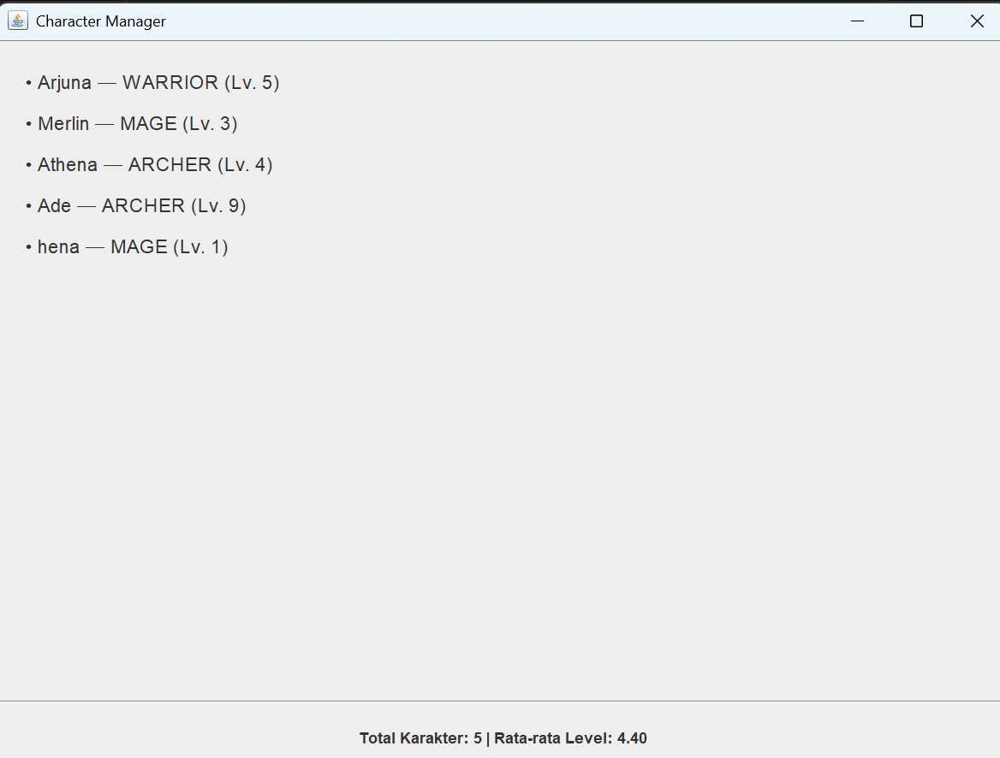

## Character Manager — TP3 (Java Visual SIH-6406)
# Deskripsi Project

Character Manager merupakan project Java yang dibuat untuk memenuhi Tugas Praktik 3 (TP3) mata kuliah Java Visual SIH-6406. Project ini mengimplementasikan konsep Object-Oriented Programming (OOP), khususnya Encapsulation, Constructor, Enum, Getter, Setter, dan Method.

Project ini memungkinkan pengguna membuat dan mengelola karakter dengan atribut seperti ID, nama, tipe karakter, level, hit points, attack power, dan mana. Selain itu, terdapat fitur Level Up dan pengecekan status karakter menggunakan method isAlive().

## Fitur Program
Membuat karakter menggunakan constructor.
Menggunakan enum untuk menentukan jenis karakter.
Menerapkan Encapsulation dengan atribut private.
Menggunakan Getter dan Setter untuk mengakses atribut.
Menghitung HP dan Attack Power berdasarkan level.
Melakukan Level Up karakter.
Menambahkan atribut Mana dengan validasi nilai negatif.
Mengecek status kehidupan karakter menggunakan isAlive().
Menampilkan informasi karakter menggunakan toString().
Screenshot Output Program

## Berikut merupakan screenshot hasil eksekusi program Character Manager:

Screenshot menampilkan hasil pembuatan karakter, demonstrasi Level Up, serta pengujian fitur Mana dan isAlive().

## Struktur Folder Project
text
javavisual-tp03-[253303621270]/
│
├── CharacterManager/
│   └── src/
│       └── com/
│           └── unpri/
│               └── charactermanager/
│                   ├── Main.java
│                   └── model/
│                       ├── Character.java
│                       └── CharacterType.java
│
├── screenshots/
│   └── output.png
│
└── README.md

Teknologi yang Digunakan
Bahasa Pemrograman: Java
JDK: Java Development Kit 17
IDE: Visual Studio Code
Version Control: Git dan GitHub

## Informasi Mahasiswa
Nama Lengkap: LOUREN KRISTIN BR BRAHMANA
NIM: 253303621270
Kelas: PAGI B
Mata Kuliah: Java Visual
Dokumentasi Analisis Desain

## Dokumentasi analisis desain dan ekosistem Java untuk Bagian D dapat diakses melalui Google Docs berikut:

[DOCS](https://drive.google.com/file/d/1a5pzSZgiHmdTFMs5o29KIncLWAodGXss/view?usp=drivesdk)]

# Character Manager — AP6 (Java Visual SIH-6406)
## Deskripsi Project

Character Manager merupakan aplikasi berbasis Java yang dikembangkan untuk memenuhi tugas praktik AP6 mata kuliah Java Visual SIH-6406. Project ini menerapkan konsep Object-Oriented Programming (OOP), khususnya Class, Object, Encapsulation, Reference, ArrayList, Static Variable, dan Method Overriding.

Aplikasi ini digunakan untuk mengelola data karakter game, mulai dari menambahkan karakter, mencari karakter berdasarkan nama, menghapus karakter, hingga menghitung jumlah karakter yang tersimpan.

Project ini juga dikembangkan dengan fitur tambahan untuk menganalisis karakter berdasarkan level, tipe, dan kekuatan serangan.

## Fitur Program
A. Core Features
Add Character — Menambahkan karakter baru ke dalam daftar.
Duplicate Validation — Menolak penambahan karakter dengan nama yang sudah terdaftar.
Find by Name — Mencari karakter berdasarkan nama.
Remove Character — Menghapus karakter dari daftar.
Get Total Characters — Menghitung jumlah karakter yang tersimpan.
Get All Characters — Mengembalikan salinan ArrayList agar data internal tetap terlindungi.
Equals Method — Membandingkan karakter berdasarkan nama.
## B. Mini-Challenge
getAverageLevel() — Menghitung rata-rata level seluruh karakter dan mengembalikan 0 jika daftar kosong.
findByType() — Mencari seluruh karakter berdasarkan jenis CharacterType.
## C. Fitur Analitik Tambahan

findStrongest()

Fitur tambahan untuk mencari karakter dengan nilai attack power tertinggi.

Fitur ini dibuat untuk membantu menganalisis karakter terkuat dalam daftar tanpa mengekspos ArrayList internal dari CharacterManager.

Screenshot Output Program

## Berikut merupakan dokumentasi hasil pengujian program melalui terminal Visual Studio Code.

Pengujian yang ditampilkan meliputi:

Penambahan karakter Arjuna, Merlin, dan Athena.
Penolakan nama karakter duplikat.
Penghitungan total karakter.
Pencarian karakter berdasarkan nama.
Penghapusan karakter.
Penampilan daftar karakter yang tersisa.

Catatan: Screenshot perlu diperbarui setelah seluruh pengujian Mini-Challenge AP6 selesai agar hasil getAverageLevel(), findByType(), dan eksperimen salinan ArrayList juga terlihat.

## Struktur Folder Project
text
CHARACTERMANAGER/
│
├── src/
│   └── com/
│       └── unpri/
│           └── charactermanager/
│               ├── Main.java
│               │
│               └── model/
│                   ├── Character.java
│                   ├── CharacterManager.java
│                   └── CharacterType.java
│
├── outputtt.png
├── outputTP05.png
│
└── README.md

## Teknologi yang Digunakan
Programming Language: Java
JDK: Java 21
IDE: Visual Studio Code
Version Control: Git
Repository: GitHub
Konsep OOP yang Diterapkan
Encapsulation: Menggunakan atribut private dan method getter/setter.
Reference: Memahami bahwa beberapa variabel dapat menunjuk object yang sama.
ArrayList: Mengelola kumpulan object Character.
Static Variable: Menyimpan data yang dimiliki bersama oleh seluruh object.
Method Overriding: Mengimplementasikan equals() untuk membandingkan nama karakter.
Defensive Copy: Mengembalikan salinan ArrayList untuk melindungi data internal.
Alasan Pemilihan Fitur Analitik

Fitur findStrongest() dipilih karena dapat membantu mengetahui karakter dengan attack power tertinggi dalam aplikasi Character Manager.

Selain memberikan informasi tambahan kepada pengguna, fitur ini juga menerapkan konsep Encapsulation karena proses pencarian dilakukan di dalam class CharacterManager tanpa memberikan akses langsung ke ArrayList internal.

## Informasi Mahasiswa
Nama Lengkap: LOUREN KRISTIN BR BRAHMANA
NIM: 253303621270
Kelas: PAGI B
Mata Kuliah: Java Visual
Tugas: AP6 — Character Manager
Dokumentasi Analisis Desain

## Analisis mengenai Java Reference, Primitive Value, Static Variable, equals(), dan Encapsulation dapat dibaca melalui Google Docs berikut:

[(https://drive.google.com/file/d/1lgrbDsuZ1SNDt5Mzoey_uO7kUBmcxiTZ/view?usp=drivesdk)]

## Character Manager – tp08
TP8: Elemen GUI Dasar (Frame / Panel / Label)

Mata Kuliah: Java Visual 
Universitas: Universitas Prima Indonesia (UNPRI)
Fakultas: Sains dan Teknologi
Program Studi: Sistem Informasi
Tahun Angkatan: 2025
Dosen Pengampu: Dr. Evta Indra

## DATA MAHASISWA
Nama Lengkap: LOUREN KRISTIN BR BRAHMANA
NIM: 253303621270
Kelas: PAGI B
Mata Kuliah: Java Visual
Tugas: AP6 — Character Manager
Dokumentasi Analisis Desain

1. Deskripsi Project

Character Manager Sprint #3 merupakan pengembangan aplikasi sederhana berbasis Java yang digunakan untuk mengelola dan menampilkan data karakter menggunakan Graphical User Interface (GUI).

Pada tahap ini, aplikasi dikembangkan dari program berbasis console menjadi aplikasi desktop menggunakan Java Swing. Komponen GUI yang digunakan meliputi JFrame, JPanel, dan JLabel.

Aplikasi menampilkan daftar karakter secara dinamis berdasarkan data yang dikelola oleh CharacterManager. Selain itu, aplikasi juga memiliki fitur perhitungan statistik berupa rata-rata level seluruh karakter.

Pengembangan ini menerapkan konsep Object-Oriented Programming (OOP), Event-Driven Programming, dan Model-View-Controller (MVC).

2. Tujuan Praktikum

Tujuan pengembangan Character Manager Sprint #3 adalah:

Memahami penggunaan JFrame sebagai jendela utama aplikasi Java Swing.
Menggunakan JPanel sebagai tempat untuk menampung komponen GUI.
Menggunakan JLabel untuk menampilkan informasi karakter.
Menampilkan data karakter secara dinamis menggunakan perulangan.
Mengimplementasikan SwingUtilities.invokeLater() untuk menjalankan GUI melalui Event Dispatch Thread (EDT).
Menghitung dan menampilkan rata-rata level karakter.
Memahami aliran data dan penerapan prinsip MVC dalam aplikasi Java.
3. Teknologi yang Digunakan
Bahasa Pemrograman: Java
GUI Framework: Java Swing
IDE: Visual Studio Code
Java Library: JFrame, JPanel, JLabel, SwingUtilities
Version Control: Git dan GitHub
Konsep Pemrograman: OOP, MVC, dan Event-Driven Programming
4. Struktur Project

Struktur project Character Manager:

text
JavaVisual-253303621270/
│
├── src/
│   ├── Main.java
│   │
│   └── com/
│       └── unpri/
│           └── charactermanager/
│               ├── model/
│               │   ├── Character.java
│               │   ├── CharacterType.java
│               │   └── CharacterManager.java
│               │
│               └── view/
│                   └── MainWindow.java
├── outputtt.png
├── outputTP05.png
├── README.md
│
└── ...

Keterangan:

Main.java: Menjadi titik awal program dan mengatur proses inisialisasi data serta menjalankan GUI.
Character.java: Menyimpan informasi setiap karakter.
CharacterType.java: Menentukan tipe karakter seperti WARRIOR, MAGE, dan ARCHER.
CharacterManager.java: Mengelola kumpulan data karakter.
MainWindow.java: Menampilkan data karakter melalui antarmuka Java Swing.
README.md: Berisi dokumentasi project dan penjelasan hasil praktikum.
5. Implementasi TP8
A. Implementasi MainWindow

Pada praktikum ini dibuat class MainWindow yang berada di package view dan menggunakan inheritance dari JFrame.

java
public class MainWindow extends JFrame {
    private JPanel mainPanel;
    private ArrayList<Character> characterList;
    private double averageLevel;
}

MainWindow memiliki dua parameter constructor, yaitu:

ArrayList<Character> characterList untuk menerima daftar karakter.
double averageLevel untuk menerima nilai rata-rata level karakter.

Jendela aplikasi menggunakan title Character Manager v0.3, ukuran 500 × 450 pixel, dan posisi jendela berada di tengah layar.

B. Menampilkan Data Karakter Secara Dinamis

Data karakter ditampilkan menggunakan perulangan enhanced for:

java
for (Character c : characterList) {
    String info = c.getName() + " | " + c.getType()
                + " | Lv." + c.getLevel()
                + " | HP:" + c.getHitPoints()
                + " | ATK:" + c.getAttackPower();

    JLabel characterLabel = new JLabel(info);
    mainPanel.add(characterLabel);
}

Dengan menggunakan perulangan tersebut, setiap karakter yang tersimpan di CharacterManager dapat ditampilkan secara otomatis tanpa harus membuat JLabel satu per satu secara manual.

C. Statistik Rata-Rata Level

Aplikasi memiliki fitur tambahan berupa statistik rata-rata level karakter.

Perhitungan dilakukan dengan mengambil seluruh level karakter, kemudian membaginya dengan jumlah karakter.

Rumus:

text
Rata-rata Level = Total Level / Jumlah Karakter

Implementasi perhitungan pada Main.java:

java
double averageLevel = characters.stream()
        .mapToInt(Character::getLevel)
        .average()
        .orElse(0.0);

Hasil perhitungan kemudian dikirimkan ke MainWindow untuk ditampilkan menggunakan JLabel.

D. Event Dispatch Thread (EDT)

Untuk menjalankan GUI, Main.java menggunakan:

java
SwingUtilities.invokeLater(() -> {
    MainWindow window = new MainWindow(characters, averageLevel);
    window.setVisible(true);
});

Penggunaan SwingUtilities.invokeLater() bertujuan agar pembuatan dan pengelolaan komponen GUI Swing dilakukan melalui Event Dispatch Thread (EDT), sehingga pengelolaan antarmuka berjalan sesuai mekanisme Swing.

6. Data Karakter

Aplikasi menggunakan minimal lima karakter dengan tipe dan level yang berbeda.

No.	Nama	Tipe	Level
1	Arjuna	WARRIOR	5
2	Merlin	MAGE	3
3	Athena	ARCHER	4
4	Gatotkaca	WARRIOR	7
5	Luna	MAGE	6

Karakter Tambahan
1. Gatotkaca

Tipe: WARRIOR
Level: 7
Alasan: Gatotkaca dipilih sebagai karakter Warrior karena menggambarkan karakter yang kuat dan memiliki kemampuan bertarung. Level 7 diberikan untuk menunjukkan karakter dengan tingkat kemampuan yang lebih tinggi.
2. Luna

Tipe: MAGE
Level: 6
Alasan: Luna dipilih sebagai karakter Mage karena menggambarkan karakter yang menggunakan kemampuan sihir. Level 6 diberikan sebagai variasi kemampuan karakter dalam aplikasi.
7. Hasil Implementasi
A. Screenshot Sebelum Penambahan Karakter
Pada tahap awal aplikasi menampilkan tiga karakter, yaitu Arjuna, Merlin, dan Athena.

Statistik rata-rata level:

(5 + 3 + 4) / 3 = 4.0

!Screenshot Sebelum Penambahan Karakter

B. Screenshot Sesudah Penambahan Karakter
Setelah menambahkan Gatotkaca dan Luna, jumlah karakter menjadi lima.

Statistik rata-rata level:

(5 + 3 + 4 + 7 + 6) / 5 = 5.0

Penambahan karakter menyebabkan nilai rata-rata level berubah dari 4.0 menjadi 5.0. Hal ini menunjukkan bahwa statistik dihitung berdasarkan data karakter yang digunakan oleh aplikasi.

8. Alur Data dan Penerapan MVC
Aplikasi Character Manager menerapkan konsep Model-View-Controller (MVC) untuk memisahkan tanggung jawab setiap bagian program.

Aliran data aplikasi:

Main → CharacterManager → MainWindow

Penjelasan:

Main: Menjadi titik awal aplikasi, membuat objek karakter, menambahkan data karakter, dan menghitung rata-rata level.
CharacterManager: Bertanggung jawab mengelola kumpulan objek Character yang telah ditambahkan.
MainWindow: Berperan sebagai View yang menerima daftar karakter dan nilai rata-rata level untuk ditampilkan menggunakan komponen GUI seperti JLabel.
Dengan pemisahan tersebut, pengelolaan data tidak dicampurkan secara langsung dengan proses penampilan antarmuka. Hal ini membuat program lebih terstruktur, mudah dipahami, dan lebih mudah dikembangkan.

9. Kesimpulan
Melalui praktikum TP8 Character Manager Sprint #3, saya mempelajari cara mengembangkan aplikasi Java berbasis console menjadi aplikasi desktop menggunakan Java Swing.

Saya memahami penggunaan JFrame, JPanel, dan JLabel dalam membangun antarmuka grafis. Saya juga mempelajari cara menampilkan data karakter secara dinamis menggunakan perulangan, menghitung rata-rata level karakter, serta menjalankan GUI menggunakan SwingUtilities.invokeLater().

Selain implementasi GUI, praktikum ini memberikan pemahaman mengenai konsep Event-Driven Programming dan Model-View-Controller (MVC). Dengan penerapan konsep tersebut, aplikasi menjadi lebih terstruktur dan memiliki pemisahan tanggung jawab antara pengelolaan data dan tampilan antarmuka.

10. Dokumentasi Analisis GUI dan MVC
Dokumentasi analisis TP8 yang membahas perbedaan program sekuensial dan event-driven, penggunaan Event Dispatch Thread, debugging JFrame, konsep is-a dan has-a, serta penerapan prinsip MVC dapat diakses melalui Google Docs berikut:

Link Google Docs:

(https://docs.google.com/document/d/1HUeWjLftskILc-ugDS0gc9JHdNEDlhJl/edit?usp=drivesdk&ouid=112205440563882970961&rtpof=true&sd=true)

## Character Manager – Sprint #4
TP10: Modifikasi Properti Komponen

Nama: Louren Kristin br Brahmana
NIM: 253303621270
Mata Kuliah: Java Visual 
Program Studi: Sistem Informasi
Universitas: Universitas Prima Indonesia
Dosen Pengampu: Dr. Evta Indra

1. Deskripsi Project

Character Manager Sprint #4 merupakan pengembangan aplikasi desktop berbasis Java Swing yang melanjutkan project dari Sprint #3.

Pada tahap ini, aplikasi dikembangkan dengan menambahkan pengaturan tema menggunakan class AppTheme.java. Pengaturan tersebut meliputi warna, font, dan border agar tampilan aplikasi lebih menarik, konsisten, dan mudah dikelola.

Selain itu, setiap kartu karakter memiliki warna background berdasarkan role masing-masing. Aplikasi juga menggunakan GridLayout untuk menyusun daftar karakter secara vertikal dan pack() untuk menyesuaikan ukuran jendela berdasarkan komponen yang terdapat di dalamnya.

Pengembangan ini menerapkan konsep Object-Oriented Programming (OOP), JavaBeans Properties, dan prinsip Model-View-Controller (MVC).

2. Tujuan Praktikum

Tujuan praktikum TP10 adalah:

Memahami penggunaan getter dan setter pada komponen Java Swing.
Memahami pengaturan properti warna, font, dan border.
Membuat class AppTheme untuk mengelola tema aplikasi.
Mengatur warna kartu karakter berdasarkan role.
Memahami penggunaan setOpaque(true) pada JLabel.
Memahami perbedaan setSize(), setPreferredSize(), dan pack().
Menggunakan logical font dan deriveFont().
Mempertahankan pemisahan tanggung jawab antara Model dan View.
3. Teknologi yang Digunakan
Bahasa Pemrograman: Java
GUI Framework: Java Swing
IDE: Visual Studio Code
Layout Manager: GridLayout
Version Control: Git dan GitHub
Konsep: OOP, MVC, JavaBeans Properties
4. Struktur Project
text
JavaVisual-253303621270/
│
├── src/
│   ├── Main.java
│   │
│   └── com/
│       └── unpri/
│           └── charactermanager/
│               ├── model/
│               │   ├── Character.java
│               │   ├── CharacterType.java
│               │   └── CharacterManager.java
│               │
│               └── view/
│                   ├── MainWindow.java
│                   └── AppTheme.java
│
├── outputtt.png
├── outputTP05.png
├── SESUDAH+CHARACTER.png
├── 
└── README.md

Keterangan:

Main.java: Menjalankan aplikasi dan menyiapkan data karakter.
Character.java: Menyimpan informasi karakter.
CharacterType.java: Menentukan tipe karakter.
CharacterManager.java: Mengelola kumpulan karakter.
MainWindow.java: Menampilkan antarmuka aplikasi menggunakan Java Swing.
AppTheme.java: Mengatur warna, font, dan border aplikasi.
README.md: Dokumentasi project.
5. Implementasi TP10
A. AppTheme.java

Pada Sprint #4 dibuat class AppTheme.java di dalam package view.

Class ini digunakan untuk mengatur tema aplikasi agar pengaturan tampilan tidak ditulis berulang kali di MainWindow.java.

AppTheme memiliki beberapa tanggung jawab:

Menyediakan minimal tiga warna.
Menyediakan minimal tiga jenis font.
Menyediakan minimal satu border.
Menyediakan method colorFor() untuk menentukan warna berdasarkan role karakter.
Menyediakan method describe() untuk memberikan deskripsi berdasarkan tipe karakter.

Dengan adanya AppTheme, pengaturan tampilan aplikasi menjadi lebih terpusat dan mudah diperbarui.

B. MainWindow.java Versi 0.4

MainWindow.java merupakan class yang bertanggung jawab menampilkan daftar karakter.

Class ini menggunakan inheritance:

java
public class MainWindow extends JFrame

Jendela aplikasi menggunakan judul:

java
super("Character Manager v0.4");

Untuk mengatur ukuran jendela, digunakan:

java
pack();
setMinimumSize(new Dimension(420, 300));
setLocationRelativeTo(null);

Penggunaan pack() membuat ukuran jendela menyesuaikan kebutuhan komponen yang ada di dalamnya.

C. Penggunaan GridLayout

Panel utama menggunakan:

java
mainPanel = new JPanel(new GridLayout(0, 1, 0, 8));

GridLayout tersebut mengatur komponen menjadi satu kolom dengan jumlah baris yang menyesuaikan jumlah komponen.

Jarak vertikal antarkomponen adalah 8 pixel sehingga kartu karakter tersusun lebih rapi.

D. Warna Kartu Berdasarkan Role

Setiap kartu karakter mendapatkan warna berdasarkan tipe karakter menggunakan:

java
lbl.setBackground(AppTheme.colorFor(c.getType()));
lbl.setOpaque(true);

Method colorFor() mengambil tipe karakter dan menentukan warna yang sesuai.

Penggunaan setOpaque(true) diperlukan agar warna background JLabel dapat terlihat.

Dengan demikian, setiap karakter memiliki tampilan kartu yang berbeda sesuai role masing-masing.

E. Pengaturan Font dan Border

Pengaturan font menggunakan properti yang disediakan oleh AppTheme:

java
lbl.setFont(AppTheme.FONT_BODY);
lbl.setForeground(AppTheme.TEXT_LIGHT);
lbl.setBorder(AppTheme.CARD_BORDER);

Judul menggunakan FONT_TITLE, sedangkan informasi karakter menggunakan FONT_BODY.

Pengaturan ini membuat tampilan lebih konsisten karena warna, font, dan border dikelola melalui satu class tema.

F. Tooltip dan Cursor

Pada versi 0.4 ditambahkan dua properti tambahan:

java
lbl.setToolTipText(AppTheme.describe(c.getType()));

lbl.setCursor(
    Cursor.getPredefinedCursor(Cursor.HAND_CURSOR)
);

Tooltip digunakan untuk memberikan informasi tambahan mengenai tipe karakter ketika pengguna mengarahkan kursor ke kartu.

Cursor HAND_CURSOR digunakan agar kursor berubah menjadi bentuk tangan ketika diarahkan ke kartu karakter.

Kedua properti tersebut membantu membuat tampilan aplikasi lebih informatif dan memberikan pengalaman penggunaan yang lebih interaktif.

6. Properti Tambahan yang Digunakan

Dua properti tambahan yang diterapkan pada Character Manager versi 0.4 adalah:

1. Tooltip

Tooltip digunakan untuk memberikan informasi tambahan mengenai role karakter.

Alasannya adalah agar pengguna dapat mengetahui deskripsi tipe karakter tanpa harus menambahkan terlalu banyak teks pada tampilan utama.

2. Hand Cursor

Hand Cursor digunakan untuk mengubah bentuk kursor menjadi tangan ketika diarahkan ke kartu karakter.

Alasannya adalah untuk memberikan petunjuk visual kepada pengguna bahwa kartu merupakan komponen yang dapat diperhatikan atau diarahkan dengan kursor.

Catatan: Pada versi ini, kartu belum memiliki event klik. Perubahan cursor hanya berfungsi sebagai petunjuk visual.

7. Penerapan Konsep MVC

Aplikasi Character Manager menggunakan pemisahan tanggung jawab berdasarkan konsep Model-View-Controller.

Model

Model bertanggung jawab menyimpan dan mengelola data karakter, seperti nama, tipe, level, HP, dan attack power.

View

View bertanggung jawab menampilkan informasi karakter melalui komponen Java Swing.

Pada Sprint #4, MainWindow.java dan AppTheme.java berada di package view.

AppTheme mengatur tampilan aplikasi, sedangkan MainWindow menampilkan data karakter.

Pemisahan ini bertujuan agar pengaturan tampilan tidak dicampurkan dengan pengelolaan data karakter.

8. Hasil Implementasi
A. Screenshot Sebelum (Versi 0.3)

Screenshot ini menunjukkan tampilan Character Manager sebelum penerapan tema pada Sprint #4.

!Character Manager v0.3

## B. Screenshot Sesudah (Versi 0.4)

Screenshot ini menunjukkan tampilan Character Manager setelah menggunakan AppTheme, pengaturan warna berdasarkan role, font, border, tooltip, dan cursor.

9. Alasan Warna Disimpan di AppTheme dan Bukan di Character

Warna merupakan bagian dari tampilan antarmuka sehingga lebih tepat diletakkan pada AppTheme yang berada di package view.

Class Character merupakan bagian dari Model yang bertugas menyimpan informasi utama karakter. Jika warna dimasukkan ke dalam Character, maka Model akan memiliki ketergantungan terhadap kebutuhan tampilan.

Dengan menyimpan warna di AppTheme, perubahan desain dapat dilakukan tanpa mengubah class Character. Selain itu, pemisahan ini membuat struktur program lebih rapi, mudah dirawat, dan sesuai dengan prinsip MVC.

10. Kesimpulan

Melalui praktikum TP10 Character Manager Sprint #4, saya mempelajari cara mengatur properti komponen Java Swing agar tampilan aplikasi menjadi lebih menarik dan terstruktur.

Saya memahami penggunaan getter dan setter, pengaturan background JLabel menggunakan setOpaque(true), penggunaan font, warna, border, serta pengaturan ukuran jendela menggunakan pack().

Saya juga mempelajari pentingnya penggunaan class AppTheme untuk memisahkan pengaturan tampilan dari pengelolaan data karakter.

Dengan penerapan konsep tersebut, aplikasi Character Manager versi 0.4 menjadi lebih 
## DOCS
[TP10](https://docs.google.com/document/d/10lwclQN3oqATZ8MMgYahcrJN3mVpS72FOpSf6rK1uUg/edit?usp=drive_link)