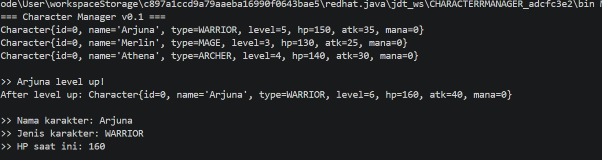

## Character Manager — TP3 (Java Visual SIH-6406)
# Deskripsi Project

Character Manager merupakan project Java yang dibuat untuk memenuhi Tugas Praktik 3 (TP3) mata kuliah Java Visual SIH-6406. Project ini mengimplementasikan konsep Object-Oriented Programming (OOP), khususnya Encapsulation, Constructor, Enum, Getter, Setter, dan Method.

Project ini memungkinkan pengguna membuat dan mengelola karakter dengan atribut seperti ID, nama, tipe karakter, level, hit points, attack power, dan mana. Selain itu, terdapat fitur Level Up dan pengecekan status karakter menggunakan method isAlive().

## Fitur Program
Membuat karakter menggunakan constructor.
Menggunakan enum untuk menentukan jenis karakter.
Menerapkan Encapsulation dengan atribut private.
Menggunakan Getter dan Setter untuk mengakses atribut.
Menghitung HP dan Attack Power berdasarkan level.
Melakukan Level Up karakter.
Menambahkan atribut Mana dengan validasi nilai negatif.
Mengecek status kehidupan karakter menggunakan isAlive().
Menampilkan informasi karakter menggunakan toString().
Screenshot Output Program

## Berikut merupakan screenshot hasil eksekusi program Character Manager:

Screenshot menampilkan hasil pembuatan karakter, demonstrasi Level Up, serta pengujian fitur Mana dan isAlive().

## Struktur Folder Project
text
javavisual-tp03-[253303621270]/
│
├── CharacterManager/
│   └── src/
│       └── com/
│           └── unpri/
│               └── charactermanager/
│                   ├── Main.java
│                   └── model/
│                       ├── Character.java
│                       └── CharacterType.java
│
├── screenshots/
│   └── output.png
│
└── README.md

Teknologi yang Digunakan
Bahasa Pemrograman: Java
JDK: Java Development Kit 17
IDE: Visual Studio Code
Version Control: Git dan GitHub

## Informasi Mahasiswa
Nama Lengkap: LOUREN KRISTIN BR BRAHMANA
NIM: 253303621270
Kelas: PAGI B
Mata Kuliah: Java Visual
Dokumentasi Analisis Desain

## Dokumentasi analisis desain dan ekosistem Java untuk Bagian D dapat diakses melalui Google Docs berikut:

[DOCS](https://drive.google.com/file/d/1a5pzSZgiHmdTFMs5o29KIncLWAodGXss/view?usp=drivesdk)]

# Character Manager — AP6 (Java Visual SIH-6406)
## Deskripsi Project

Character Manager merupakan aplikasi berbasis Java yang dikembangkan untuk memenuhi tugas praktik AP6 mata kuliah Java Visual SIH-6406. Project ini menerapkan konsep Object-Oriented Programming (OOP), khususnya Class, Object, Encapsulation, Reference, ArrayList, Static Variable, dan Method Overriding.

Aplikasi ini digunakan untuk mengelola data karakter game, mulai dari menambahkan karakter, mencari karakter berdasarkan nama, menghapus karakter, hingga menghitung jumlah karakter yang tersimpan.

Project ini juga dikembangkan dengan fitur tambahan untuk menganalisis karakter berdasarkan level, tipe, dan kekuatan serangan.

## Fitur Program
A. Core Features
Add Character — Menambahkan karakter baru ke dalam daftar.
Duplicate Validation — Menolak penambahan karakter dengan nama yang sudah terdaftar.
Find by Name — Mencari karakter berdasarkan nama.
Remove Character — Menghapus karakter dari daftar.
Get Total Characters — Menghitung jumlah karakter yang tersimpan.
Get All Characters — Mengembalikan salinan ArrayList agar data internal tetap terlindungi.
Equals Method — Membandingkan karakter berdasarkan nama.
## B. Mini-Challenge
getAverageLevel() — Menghitung rata-rata level seluruh karakter dan mengembalikan 0 jika daftar kosong.
findByType() — Mencari seluruh karakter berdasarkan jenis CharacterType.
## C. Fitur Analitik Tambahan

findStrongest()

Fitur tambahan untuk mencari karakter dengan nilai attack power tertinggi.

Fitur ini dibuat untuk membantu menganalisis karakter terkuat dalam daftar tanpa mengekspos ArrayList internal dari CharacterManager.

Screenshot Output Program

## Berikut merupakan dokumentasi hasil pengujian program melalui terminal Visual Studio Code.

Pengujian yang ditampilkan meliputi:

Penambahan karakter Arjuna, Merlin, dan Athena.
Penolakan nama karakter duplikat.
Penghitungan total karakter.
Pencarian karakter berdasarkan nama.
Penghapusan karakter.
Penampilan daftar karakter yang tersisa.

Catatan: Screenshot perlu diperbarui setelah seluruh pengujian Mini-Challenge AP6 selesai agar hasil getAverageLevel(), findByType(), dan eksperimen salinan ArrayList juga terlihat.

## Struktur Folder Project
text
CHARACTERMANAGER/
│
├── src/
│   └── com/
│       └── unpri/
│           └── charactermanager/
│               ├── Main.java
│               │
│               └── model/
│                   ├── Character.java
│                   ├── CharacterManager.java
│                   └── CharacterType.java
│
├── outputtt.png
├── outputTP05.png
│
└── README.md

## Teknologi yang Digunakan
Programming Language: Java
JDK: Java 21
IDE: Visual Studio Code
Version Control: Git
Repository: GitHub
Konsep OOP yang Diterapkan
Encapsulation: Menggunakan atribut private dan method getter/setter.
Reference: Memahami bahwa beberapa variabel dapat menunjuk object yang sama.
ArrayList: Mengelola kumpulan object Character.
Static Variable: Menyimpan data yang dimiliki bersama oleh seluruh object.
Method Overriding: Mengimplementasikan equals() untuk membandingkan nama karakter.
Defensive Copy: Mengembalikan salinan ArrayList untuk melindungi data internal.
Alasan Pemilihan Fitur Analitik

Fitur findStrongest() dipilih karena dapat membantu mengetahui karakter dengan attack power tertinggi dalam aplikasi Character Manager.

Selain memberikan informasi tambahan kepada pengguna, fitur ini juga menerapkan konsep Encapsulation karena proses pencarian dilakukan di dalam class CharacterManager tanpa memberikan akses langsung ke ArrayList internal.

## Informasi Mahasiswa
Nama Lengkap: LOUREN KRISTIN BR BRAHMANA
NIM: 253303621270
Kelas: PAGI B
Mata Kuliah: Java Visual
Tugas: AP6 — Character Manager
Dokumentasi Analisis Desain

## Analisis mengenai Java Reference, Primitive Value, Static Variable, equals(), dan Encapsulation dapat dibaca melalui Google Docs berikut:

[(https://drive.google.com/file/d/1lgrbDsuZ1SNDt5Mzoey_uO7kUBmcxiTZ/view?usp=drivesdk)]

